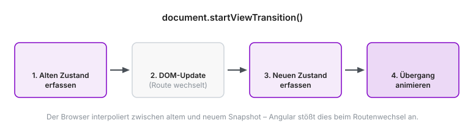
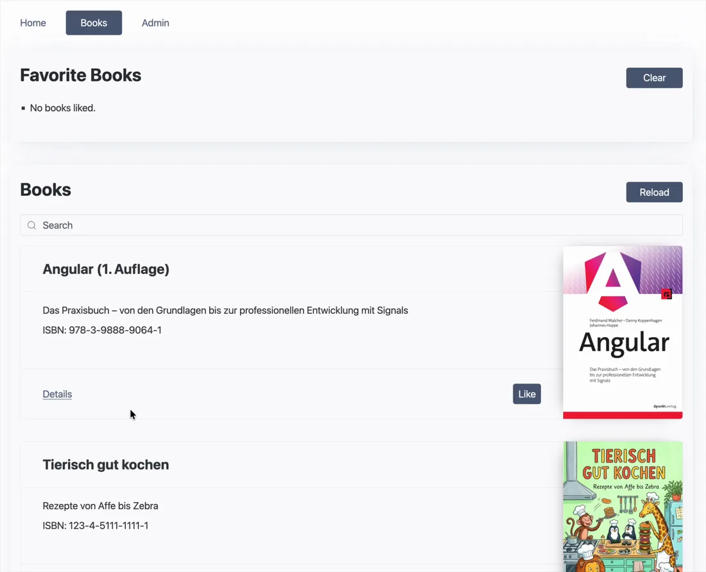
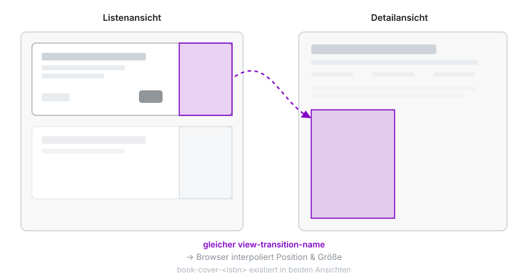
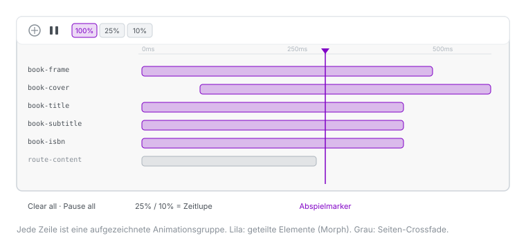

Ein Routenwechsel in einer Single-Page-Anwendung ist meist ein harter Schnitt: Die eine Ansicht verschwindet, die nächste erscheint. Mit der View Transitions API des Browsers lässt sich dieser Wechsel in eine flüssige Animation verwandeln.
Das Beste dabei: Angular bringt die passende Integration gleich mit.

In diesem Artikel bauen wir eine Übergangsanimation zwischen einer Buchliste und einer Detailseite zu einem Buch.
Das Ziel: Die Listen-Card „zoomt“ zur Detailseite, während Cover, Titel, Untertitel und ISBN von ihrer Position in der Liste an ihre neue Position auf der Detailseite wandern.
Neu hinzukommende Inhalte wie Autoren und Beschreibung blenden sanft ein.
Das Ganze funktioniert ohne zusätzliche Abhängigkeit, allein mit der Browser-API und ein wenig CSS.
In Browsern ohne Unterstützung der modernen View Transition API degradiert der Übergang sauber zum gewohnten Verhalten.

> ⚠️ **Developer Preview:** Die hier genutzten Funktionen `withViewTransitions()` und `withRouterResources()` sind in Angular 22 als Developer Preview markiert.
> Die APIs können sich in zukünftigen Versionen noch ändern.

## Inhalt

[[toc]]

## Was sind View Transitions?

Die [View Transitions API](https://developer.mozilla.org/en-US/docs/Web/API/View_Transition_API) ist eine native Browser-Schnittstelle, die Übergänge zwischen zwei Zuständen einer Oberfläche animiert.
Der Kern ist die Methode `document.startViewTransition()`.
Sie bekommt einen Callback, der die eigentliche DOM-Änderung vornimmt, und kümmert sich um alles Weitere.

Der Browser arbeitet dabei in vier Phasen:
Zuerst erfasst er den aktuellen Zustand der Seite als Momentaufnahme.
Dann führt er das DOM-Update aus unserem Callback aus.
Anschließend erfasst er den neuen Zustand.
Zum Schluss animiert er den Übergang zwischen beiden Momentaufnahmen.



Für die Animation legt der Browser im Hintergrund einen Baum aus Pseudo-Elementen an:
Pro benanntem Bereich entstehen eine `::view-transition-group()`, die Position und Größe interpoliert, sowie ein `::view-transition-old()` und ein `::view-transition-new()`, die den alten und neuen Schnappschuss überblenden.
Diese Pseudo-Elemente lassen sich mit CSS gezielt ansprechen.
Genau darüber steuern wir später die Animation.

Wichtig zur Einordnung: Hier ist keine Angular-eigene Animations-Engine im Spiel. Es handelt sich um eine reine Browser-API. Angular klinkt sie lediglich in den Navigationszyklus des Routers ein.

Noch ein Detail, das man kennen sollte: Während der Übergang läuft, legt der Browser die Pseudo-Element-Schicht als Überlagerung über die eigentliche Seite. Der alte Zustand wird dabei als statisches Bild festgehalten, der neue Zustand als Live-Abbild des neuen DOM.
Diese Überlagerung fängt standardmäßig Zeiger-Interaktionen ab, sodass die Seite für die Dauer der Animation praktisch nicht bedienbar ist.
Das ist ein guter Grund, Übergänge kurz zu halten (in unserem Beispiel rund eine halbe Sekunde): Je länger die Animation, desto länger kann die nutzende Person nicht klicken oder scrollen.

### Zwei Spielarten: SPA (same-document) vs. MPA (cross-document)

Die View Transitions API deckt zwei unterschiedliche Szenarien ab, jedes mit einem eigenen Einstiegspunkt:

- **Same-document (SPA):** Der Übergang findet zwischen zwei DOM-Zuständen *innerhalb* derselben Seite statt. Er wird imperativ über `document.startViewTransition(callback)` ausgelöst. Genau diesen Weg nutzt der Angular-Router intern.
- **Cross-document (MPA):** Der Übergang findet bei der Navigation *zwischen* zwei Dokumenten statt. Er wird deklarativ über die CSS-At-Rule `@view-transition { navigation: auto; }` aktiviert, und beide Seiten müssen von derselben Origin stammen. Das ist der Weg für klassische, serverseitig gerenderte Seiten ohne Framework.

Da eine Angular-Anwendung eine SPA ist, geht es im weiteren Verlauf ausschließlich um den same-document-Weg.
Die MPA-Variante ist ein eigenes Thema – sie kommt ganz ohne JavaScript aus – und ist hier nur zur Einordnung erwähnt.

### Browser-Support und Stand

Same-document View Transitions werden in Chrome und Edge ab Version 126 sowie in Safari ab 18.2 unterstützt.
In Firefox ist bisher der SPA-Teil noch nicht umgesetzt, es wird aber daran gearbeitet.
Die API ist damit noch nicht flächendeckend als „Baseline“ verfügbar.

Genau deshalb ist der Charakter als *Progressive Enhancement* so wichtig: In Browsern ohne Unterstützung führt Angular den Routenwechsel einfach ohne Animation aus.
Somit bleibt die Anwendung voll funktionsfähig.
Da sich der Support laufend ändert, lohnt sich ein Blick auf die aktuelle [Browser-Kompatibilitätstabelle bei MDN](https://developer.mozilla.org/en-US/docs/Web/API/View_Transition_API#browser_compatibility).

## Das Beispielprojekt

Als Grundlage dient der [`book-manager` aus dem Angular-Buch in der Variante `15-rxjs`](https://bm1.angular-buch.com/#bm15). Die Anwendung hat zwei relevante Routen: eine Buchliste (`BooksOverviewPage`, die pro Buch eine `BookCard` rendert) und eine Detailseite (`BookDetailsPage`). Beide arbeiten mit demselben Datenmodell `Book`, das unter anderem ISBN, Titel, Untertitel, Autoren, Beschreibung, die Cover-URL und ein Erstellungsdatum enthält.

Ohne weitere Konfiguration ist der Wechsel von der Liste zur Detailansicht ein harter Schnitt. Diesen Übergang bauen wir Schritt für Schritt zu einer zusammenhängenden Animation aus.



### View Transitions im Router aktivieren

Der erste Schritt ist denkbar klein: Wir ergänzen die Router-Konfiguration um das Feature `withViewTransitions()`.
Von da an ruft der Router bei jeder Navigation automatisch `document.startViewTransition()` auf und wickelt den Routenwechsel darin ab.

```typescript
// app.config.ts
export const appConfig: ApplicationConfig = {
  providers: [
    provideBrowserGlobalErrorListeners(),
    provideRouter(
      routes,
      withComponentInputBinding(),
      withViewTransitions()       // aktiviert View Transitions
    )
  ]
};
```

Unterstützt der Browser die API nicht, bleibt alles beim normalen DOM-Wechsel – ohne Fehler, ohne Sonderbehandlung.

Schon jetzt gibt es einen sichtbaren Effekt: Der gesamte Seiteninhalt wird beim Routenwechsel sanft übergeblendet.
Das ist das Standardverhalten, das der Browser mit einem automatischen `root`-Übergang mitbringt.

### Ein grundlegender Seitenübergang per CSS

Bevor wir zu den geteilten Elementen kommen, lohnt ein Blick auf den einfachsten Fall: einen gleichmäßigen Übergang des gerouteten Inhalts.
Dazu geben wir dem Element direkt hinter dem `router-outlet` einen `view-transition-name` und definieren zwei Keyframe-Animationen für das Ein- und Ausblenden.

```css
/* styles.css */
router-outlet + * {
  view-transition-name: route-content;
}

@keyframes route-fade-out {
  from { opacity: 1; transform: translateY(0); }
  to   { opacity: 0; transform: translateY(-10px); }
}

@keyframes route-fade-in {
  from { opacity: 0; transform: translateY(10px); }
  to   { opacity: 1; transform: translateY(0); }
}

::view-transition-old(route-content) {
  animation: 200ms ease-out both route-fade-out;
}

::view-transition-new(route-content) {
  animation: 300ms ease-in both route-fade-in;
}
```

Ein entscheidender Punkt: Diese Regeln gehören zwingend in die **globalen** Styles, nicht in die gekapselten Styles einer Komponente.
Angulars View Encapsulation versieht komponentenlokale Stile mit Attributselektoren.
Die vom Browser erzeugten `::view-transition-*`-Pseudo-Elemente liegen aber außerhalb jeder Komponente und würden von solchen Selektoren nicht erreicht.

### Shared-Element-Transitions für Cover und Titel

Jetzt kommt der eigentlich spannende Teil.
Die Idee hinter einer Shared-Element-Transition ist einfach: Trägt ein Element in *beiden* Ansichten denselben `view-transition-name`, erkennt der Browser es als dasselbe Element wieder und interpoliert Position und Größe von der alten zur neuen Lage.
Der Effekt: Es *wandert* sichtbar, statt zu verschwinden und neu zu erscheinen.



Die Namen müssen dabei pro Übergang eindeutig sein.
In der Liste gibt es aber viele `BookCard`-Instanzen gleichzeitig, die über `@for` iteriert werden.
Würden alle Cover denselben Namen tragen, käme es zum Konflikt.
Deshalb leiten wir den Namen aus der ISBN des jeweiligen Buchs ab, etwa `book-cover-<isbn>` und `book-title-<isbn>`.
Zusätzlich vergeben wir eine `view-transition-class`, über die wir später alle gleichartigen Elemente mit einer einzigen CSS-Regel ansprechen können.

In der `BookCard` sieht das für Cover und Titel so aus:

```html
<!-- book-card.html (Ausschnitt) -->

<h2 [id]="titleId"
  [style.view-transition-name]="'book-title-' + b.isbn"
  [style.view-transition-class]="'book-title'">{{ b.title }}</h2>
```

Auf der Detailseite geben wir im Anschluss dem großen Cover und der Überschrift dieselben Namen.
Damit kann der Browser nun die entsprechenden Paare finden:

```html
<!-- book-details-page.html (Ausschnitt) -->
<h1 [id]="titleId"
  [style.view-transition-name]="'book-title-' + b.isbn"
  [style.view-transition-class]="'book-title'">{{ b.title }}</h1>

```

Beim Styling lauert ein verbreiteter Stolperstein.
Verlockend wäre es, auf `::view-transition-old()` und `::view-transition-new()` eigene `transform`-Keyframes zu legen, um die Bewegung direkt zu steuern.
Genau das würde aber den Effekt zerstören: Die automatische Interpolation von Position und Größe steckt bereits in der `::view-transition-group()`.
Überschreibt man `old`/`new` mit eigenen Transforms, bleibt nur noch ein Überblenden: das Element faded, statt zu wandern.

Richtig ist, die Bewegung dem Browser zu überlassen und über die Gruppe nur Dauer und Easing vorzugeben.
Das `old`/`new`-Paar überblenden wir lediglich sauber ineinander:

```css
::view-transition-group(.book-cover) {
  animation-duration: 500ms;
  animation-timing-function: cubic-bezier(0.22, 0.61, 0.36, 1);
}

::view-transition-old(.book-cover),
::view-transition-new(.book-cover) {
  animation-duration: 500ms;
  animation-timing-function: cubic-bezier(0.22, 0.61, 0.36, 1);
  /* Höhe an die Gruppe koppeln, damit das Bild beim Wandern nicht verzerrt */
  height: 100%;
}
```

### Daten synchron bereitstellen mit Router Resources

An dieser Stelle stößt man schnell auf ein (vielleicht überraschendes) Problem: Das Cover faded statt zu wandern, obwohl alles korrekt benannt ist.
Der Grund liegt im Timing.

Angular wartet bei View Transitions bewusst *nicht* auf asynchrone Daten.
Lädt die Detailseite ihr Buch per `httpResource` erst nach der Aktivierung, ist das DOM in dem Moment, in dem der Browser den neuen Zustand erfasst, noch leer: Es existiert also weder die Überschrift noch das Cover.
Für die geteilten Elemente existiert dann nur ein `::view-transition-old()`, aber kein `::view-transition-new()`.
Es gibt also kein Gegenstück, zu dem hin interpoliert werden könnte.
Das Ergebnis ist genau das beobachtete Ausblenden statt eines Morphs.


Die Lösung: Das Buch muss schon beim Aktivieren der Route synchron vorliegen.
Dafür nutzen wir eine *blockierende* Route-Resource, die mit Angular 22.2.0 als experimentell eingeführt wurde.
<!--Für Details dazu haben wir einen eigenständigen Artikel geschrieben.-->
<!--TODO: Artikel schrieben und hier verlinken-->
Dafür aktivieren wir jetzt das Router-Feature `withRouterResources()`:

```typescript
// app.config.ts (Ausschnitt)
provideRouter(
  routes,
  withComponentInputBinding(),
  withViewTransitions(),
  withRouterResources()       // aktiviert Route-Resources
)
```

Mit `withRouterResources()` lädt der Router das Buch, bevor er die Komponente aktiviert, und bindet das Ergebnis über `withComponentInputBinding()` direkt an ein `book`-Input.
Da das Projekt im RxJS-Kapitel angesiedelt ist, verwenden wir `rxResource` mit der `stream`-Eigenschaft:

```typescript
// books-portal.routes.ts (Ausschnitt)
{
  path: 'details/:isbn',
  component: BookDetailsPage,
  resources: (ctx) => {
    const bookStore = inject(BookStore);
    return {
      book: rxResource({
        params: () => ctx.params()['isbn'] as string,
        stream: ({ params: isbn }) => bookStore.getById(isbn)
      })
    };
  }
}
```

Die Komponente schrumpft dadurch auf das Wesentliche.
Statt eine Resource selbst zu verwalten, nimmt sie das fertige Buch einfach als Input entgegen:

```typescript
// book-details-page.ts
export class BookDetailsPage {
  readonly book = input.required<Book>();   // kommt aus der blockierenden Resource
  // ...
}
```

Dass `nonBlocking()` hier keine Alternative ist, ergibt sich aus demselben Timing-Argument: Eine nicht blockierende Resource würde die Komponente sofort ohne Wert rendern.
Der Effekt: Wir landen wieder beim Fade.

Ein Trade-off bei der Nutzung von Route-Resources bleibt aber ehrlicherweise bestehen: Die Navigation wartet kurz auf den Request, bevor der Übergang startet.
Bei einer schnellen API ist das kaum wahrnehmbar.
Dafür gibt es einen praktischen Zusatznutzen: Im Fall einer unbekannten ISBN, bei dem die blockierende Resource die Navigation abbrechen würde, lässt sich im Loader ein `RedirectCommand` werfen und so sauber umleiten.
Im Minimalbeispiel haben wir an dieser Stelle aber darauf verzichtet.

> **Route Resources oder klassischer Resolver?** Der Gedanke, Daten „vor der Aktivierung“ blockierend zu laden, ist nicht neu: klassischerweise haben wir dafür einen *Resolver* genutzt (`ResolveFn<T>`, registriert unter `resolve` in der Route).
> Resolver und Route-Resource teilen genau die Eigenschaft, auf die es uns hier ankommt: Beide blockieren die Navigation und stellen das Ergebnis über `withComponentInputBinding()` synchron als Input bereit.
> Für unseren Shared-Element-Morph wäre ein Resolver also grundsätzlich ebenso geeignet.
>
> Dass hier dennoch Route-Resources zum Einsatz kommen, ist eine bewusste, keine dogmatische Entscheidung. Route-Resources sind signal-basiert und somit auch reaktiv: ändert sich ein Routenparameter, lädt die Resource neu, und ein `reload()` ist ohne erneute Navigation möglich.
> Über die Routen-Hierarchie laufen mehrere Resources zudem *parallel*, während Resolver von der Eltern- zur Kindroute nacheinander abgearbeitet werden.
> Außerdem fügen sie sich konsistent in ein Projekt ein, das ohnehin mit `httpResource` und Signals arbeitet, und `nonBlocking()` steht als expliziter Opt-out bereit, wenn man den Ladezustand doch in der Komponente behandeln möchte.
> Die Fehlerbehandlung funktioniert in beiden Welten ähnlich: Resolver fangen Fehler über `catchError()` ab oder nutzen `withNavigationErrorHandler()`, eine Route-Resource wirft im Loader ein `RedirectCommand`.
>
> Wer Resolver im Projekt hat und zufrieden damit ist, muss nichts umbauen – sie bleiben ein valides Werkzeug. Eine ausführliche Behandlung inklusive Fehlerbehandlung und der UX-Problematik blockierender Navigation findet sich im Buch-Zusatzmaterial [Resolvers: Daten beim Routing vorladen](/material/resolvers).
> Dort argumentieren wir, dass blockierende Resolver aus UX-Sicht meist ungünstig sind.
> Unser Fall ist die begründete Ausnahme: Hier ist das synchrone Vorliegen der Daten nicht bloß Komfort, sondern technische Voraussetzung dafür, dass die View Transition überhaupt morphen kann.
> Hinzu kommt, dass die View Transition selbst die wahrgenommene Wartezeit überbrückt: Der animierte Übergang vermittelt – anders als ein harter Schnitt mit kurzer Pause – nicht das Gefühl, dass nichts passiert.

### Weitere zuordenbare Elemente und das Ein- und Ausblenden

Nach demselben Prinzip, das wir eben kennengelernt haben, lassen sich beliebig viele Elemente paaren.
Alles, was in beiden Ansichten vorkommt, bekommt einen geteilten Namen.
Also zusätzlich zum Cover und Titel auch der Untertitel (`book-subtitle-<isbn>`) und die ISBN (`book-isbn-<isbn>`).
Selbst dem umgebenden `<article>` geben wir einen Namen (`book-frame-<isbn>`).
Dadurch morpht der Rahmen als Ganzes, und die kompakte Listen-Card „zoomt" sichtbar zur ausgedehnten Detailseite.

Elemente, die nur in einer der beiden Ansichten existieren, behandelt der Browser automatisch sinnvoll: Neue Inhalte wie Autoren, Beschreibung und Datum blenden über den Standard-Überblendeffekt des Frames ein.

Interessant ist das Zusammenspiel von Rahmen und Inhalt. Ein benanntes Kind-Element wird aus seinem benannten Vorfahren „herausgehoben“ und als eigene Top-Level-Gruppe animiert.
Der Frame morpht also, ohne Cover, Titel und Co. mitzuzerren: Diese wandern unabhängig obendrauf.
So entsteht die zusammengesetzte Choreografie aus einem zoomenden Rahmen und mehreren eigenständig wandernden Elementen.

### Bereiche gezielt sofort ausblenden statt faden

Der Aktions-`<footer>` der Card mit dem Link „Details“ und dem Button „Like“ existiert auf der Detailseite nicht.
Über den Überblendeffekt des Frames würde er langsam ausfaden.
Wir wollen aber, dass der gesamte Footer sofort verschwindet.

Die saubere Lösung ist, dem gesamten `<footer>` einen eigenen `view-transition-name` samt Klasse `book-actions` zu geben.
Da das Element nur in der Liste vorkommt, entsteht für ihn ausschließlich ein `::view-transition-old()`, aber kein `new` und keine `group`.

Hier lauert noch eine Feinheit: `animation: none` wäre falsch, denn das ließe die Momentaufnahme über die gesamte Transition stehen.
Der Footer bliebe also sichtbar.
Stattdessen setzen wir ihn in einem einzigen Schritt einfach auf `opacity: 0`:

```css
::view-transition-old(.book-actions) {
  animation: 1ms step-end both book-actions-hide;
}

@keyframes book-actions-hide {
  from, to { opacity: 0; }
}
```

Dieses Muster – ein eigener Name kombiniert mit einem `opacity: 0`-Keyframe – ist der allgemeine Weg, um Bereiche, die nur in einer Ansicht vorkommen, gezielt sofort ein- oder auszublenden, statt sie zu faden.

### Feinschliff: zeitlicher Versatz

Ein Übergang wirkt lebendiger, wenn sich nicht alle Elemente exakt gleichzeitig bewegen, sondern leicht gestaffelt.
In unserem Beispiel startet das Cover seine Wanderung bewusst 100 Millisekunden nach dem Rahmen und den übrigen Elementen.
Umgesetzt wird das über `animation-delay` auf der Cover-Gruppe.
Mit `animation-fill-mode: both` bleibt das Cover während der Verzögerung an seiner Startposition stehen, statt zu springen:

```css
::view-transition-group(.book-cover) {
  animation-duration: 500ms;
  animation-delay: 100ms;      /* startet versetzt */
  animation-fill-mode: both;   /* hält Start-/Endbild in der Verzögerung */
  animation-timing-function: cubic-bezier(0.22, 0.61, 0.36, 1);
}
```

Denselben `animation-delay` und `animation-fill-mode` setzen wir auch auf `::view-transition-old(.book-cover)` und `::view-transition-new(.book-cover)`, damit Überblendung und Positions-Morph synchron bleiben.
Im nächsten Abschnitt sehen wir, dass dieser Versatz in den DevTools gut sichtbar wird: In der Zeitleiste beginnt die Cover-Spur erkennbar später als die des Rahmens.

## Untersuchung und Nachvollziehbarkeit mit den Chrome DevTools

Eine View Transition läuft in etwa einer halben Sekunde ab.
Das ist oftmals zu schnell, um mit bloßem Auge zu beurteilen, ob ein Element wirklich wandert oder nur überblendet.
Die Chrome DevTools bringen mit dem Animations-Panel ein Werkzeug mit, das genau diese Analyse ermöglicht.
Die offizielle Dokumentation dazu findet sich unter [Inspect CSS animations](https://developer.chrome.com/docs/devtools/css/animations/).

### Das Animations-Panel öffnen

Am schnellsten geht es über das Command-Menü: Mit `Cmd`/`Ctrl` + `Shift` + `P` die Eingabe „Show Animations“ aufrufen.
Alternativ lässt sich das Panel über das Drawer-Menü („More tools" → „Animations") öffnen.
Das Panel zeigt die aufgezeichneten Animationsgruppen untereinander, jeweils als Balken auf einer gemeinsamen Zeitleiste, und bietet einen Abspielmarker, mit dem man die Animation manuell durch die Zeit ziehen kann.



### Aufzeichnen und wiederholen

Das Panel zeichnet automatisch auf, sobald eine Animation startet.
Es genügt also, bei geöffnetem Panel die Navigation auszulösen: In unserem Fall also ein Klick auf „Details“.
Die aufgezeichnete Transition erscheint als Gruppe von Zeitleisten-Spuren, und über den Replay-Button lässt sie sich beliebig oft erneut abspielen, ohne erneut navigieren zu müssen.
Hier tauchen die einzelnen Gruppen namentlich auf, etwa `::view-transition-group(book-cover-…)`.
Mit dem Abspielmarker lässt sich der Übergang von Hand durch die Zeit ziehen, sodass man jeden Zwischenzustand in Ruhe betrachten kann.

### Verlangsamen für die Analyse

Im Panel lässt sich die Abspielgeschwindigkeit reduzieren, etwa auf 25 % oder 10 %. In dieser Zeitlupe wird unmittelbar sichtbar, was im Normaltempo verborgen bleibt: Verändert ein Element Position und Größe, läuft also tatsächlich eine `group`-Animation, dann funktioniert die Shared-Element-Transition.
Blendet es dagegen nur ein oder aus, handelt es sich um ein reines Fade – ein deutliches Zeichen dafür, dass das Gegenstück im neuen DOM fehlt.

### Nachweis: Morph oder Fade?

Wer es genau wissen will, kann die laufenden Pseudo-Element-Animationen auch programmatisch auslesen.
`document.getAnimations()` liefert alle aktiven Animationen, über deren `effect.pseudoElement` sich die zugehörigen `::view-transition-*`-Namen ablesen lassen.
Das Erfolgskriterium ist eindeutig: Existiert für ein geteiltes Element sowohl eine `::view-transition-group(name)` als auch ein `::view-transition-new(name)`, handelt es sich um einen echten Morph.
Findet sich dagegen nur ein `::view-transition-old(name)` ohne `new` und ohne `group`, fehlt das Element im neuen DOM – es kann nur faden.
Das ist typischerweise die Signatur asynchron geladener Daten und führt direkt zurück zu unserer Lösung mit den Router Resources oder alternativ Resolvern.
Zusätzlich lassen sich `transform`, `width` und `height` der Gruppe am Anfang und Ende auslesen, um die Interpolation schwarz auf weiß zu belegen.

## Barrierefreiheit: `prefers-reduced-motion`

Beim Thema Bewegung sind zwei Konzepte sauber auseinanderzuhalten. Das eine ist Progressive Enhancement im Sinne fehlender Browser-Fähigkeiten.
Das deckt die View Transitions API bereits selbst ab, indem Angular ohne Unterstützung ein normales DOM-Update macht.
Das andere ist `prefers-reduced-motion`: eine bewusste Nutzerpräferenz, etwa bei vestibulären Beschwerden.
Das ist kein Fähigkeits-Fallback, sondern eine Opt-out-Entscheidung der nutzenden Person.

Für diese Präferenz empfiehlt sich eine „opt-in“-Logik statt eines nachträglichen Abschaltens.
Anstatt immer zu animieren und bei `reduce` jede Regel wieder zu deaktivieren, kapseln wir sämtliche Animationsregeln in `@media (prefers-reduced-motion: no-preference)`.
Fehlt die Zustimmung – sei es durch `reduce` oder weil der Browser die Media Query nicht kennt – greifen unsere Keyframes gar nicht erst.
Das ist robuster und erspart einen langen Abschalt-Block, in dem man leicht eine Regel vergisst.

```css
/* Animationen nur, wenn keine Reduktion gewünscht ist (opt-in) */
@media (prefers-reduced-motion: no-preference) {
  ::view-transition-group(.book-cover) {
    animation-duration: 500ms;
    animation-timing-function: cubic-bezier(0.22, 0.61, 0.36, 1);
  }
  /* … alle weiteren View-Transition-Regeln hier hinein … */
}
```

Dieses CSS deaktiviert allerdings nur *unsere eigenen* Keyframes.
Die View Transition als solche läuft weiter – inklusive des browser-eigenen Standard-Überblendeffekts, der auch den gesamten Seiteninhalt betrifft.
Für eine saubere Umsetzung sollten wir den Übergang bei `reduce` deshalb ganz überspringen.

Genau dafür bietet Angulars View-Transitions-Integration eine Feature an.
`withViewTransitions()` akzeptiert ein Optionsobjekt mit dem Callback `onViewTransitionCreated`.
Dieser läuft in einem Injection-Kontext und bekommt unter anderem die native `ViewTransition`-Instanz übergeben.
Darauf können wir `skipTransition()` aufrufen, was dazu führt, dass Animation übersprungen werden.
Das DOM-Update (also den Routenwechsel) wir allerdings trotzdem ausgeführt:

```typescript
// app.config.ts
provideRouter(
  routes,
  withComponentInputBinding(),
  withViewTransitions({
    onViewTransitionCreated: ({ transition }) => {
      const prefersReducedMotion =
        matchMedia('(prefers-reduced-motion: reduce)').matches;
      if (prefersReducedMotion) {
        transition.skipTransition();
      }
    }
  }),
  withRouterResources()
)
```

Damit haben wir beide Ebenen abgedeckt: Das CSS mit `no-preference` definiert unsere Animationen erst gar nicht, und `skipTransition()` unterbindet zusätzlich den browser-eigenen Standardübergang.
In beiden Fällen gilt: Inhalt und Navigation bleiben voll funktionsfähig, lediglich die zusätzliche Bewegung entfällt.

## Zusammenfassung

Mit der View Transitions API lassen sich Routenwechsel in Angular ohne zusätzliche Abhängigkeit animieren: Als Progressive Enhancement, das in nicht unterstützenden Browsern sauber zum normalen Verhalten degradiert.
Drei Bausteine tragen das Ergebnis: `withViewTransitions()` aktiviert die Integration, geteilte `view-transition-name`-Werte verwandeln einzelne Elemente in wandernde Shared Elements, und eine blockierende Route-Resource stellt die Daten synchron bereit, damit beim Erfassen des neuen Zustands tatsächlich etwas zu morphen da ist.
Die Chrome DevTools mit ihrem Animations-Panel und der Möglichkeit zum Verlangsamen sind dabei das Werkzeug der Wahl, um einen Übergang Schritt für Schritt zu analysieren.

Von hier aus lässt sich weiterdenken: View Transition Types für unterschiedliche Übergangsstile je nach Navigationsrichtung, eine eigene Choreografie für den Rückweg von der Detailseite zur Liste oder komplexere gestaffelte Abläufe.
Und nicht vergessen: Sowohl die View-Transitions- als auch die Router-Resources-Integration sind in Angular 22 noch Developer Preview.

## Weiterführende Links

- Angular Guide: [Route transition animations](https://angular.dev/guide/routing/route-transition-animations)
- Angular Guide: [Data fetching with resources](https://next.angular.dev/guide/routing/data-fetching-with-resources)
- Buch-Zusatzmaterial: [Resolvers – Daten beim Routing vorladen](/material/resolvers)
- Chrome DevTools: [Animationen inspizieren](https://developer.chrome.com/docs/devtools/css/animations/)
- Chrome Blog: [What's new in view transitions (2025)](https://developer.chrome.com/blog/view-transitions-in-2025)
- MDN: [View Transition API](https://developer.mozilla.org/en-US/docs/Web/API/View_Transition_API)
- MDN: [Browser-Kompatibilität der View Transition API](https://developer.mozilla.org/en-US/docs/Web/API/View_Transition_API#browser_compatibility)
- MDN: [`@view-transition` – cross-document / MPA](https://developer.mozilla.org/en-US/docs/Web/CSS/@view-transition)
