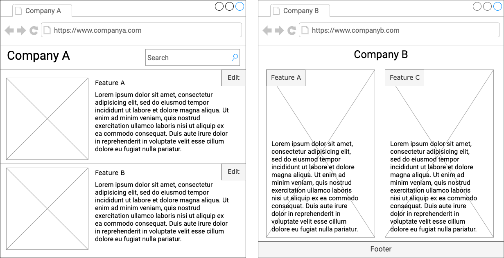
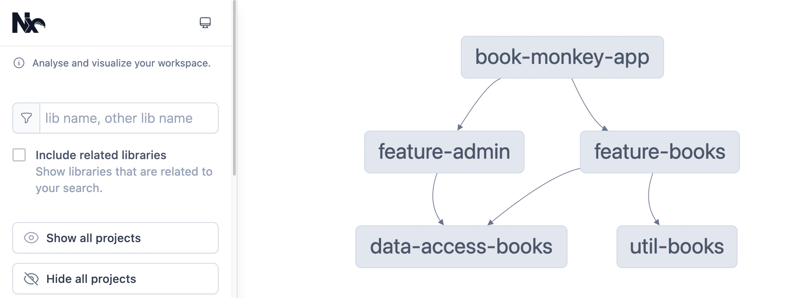

Mit `ng new` entsteht nicht nur eine Angular-Anwendung, sondern immer auch ein *Workspace*.
Oft enthält er genau eine Anwendung, aber das muss nicht so bleiben:
Die Angular CLI kann in einem einzigen Workspace mehrere Anwendungen und Bibliotheken verwalten.

In diesem Artikel geht es darum, wie du diese Bordmittel der Angular CLI einsetzt.
Das ist bewusst kein Grundlagenartikel zu Monorepos:
Wir vergleichen keine Repository-Strategien und diskutieren auch nicht, wann sich ein Monorepo für dein Unternehmen lohnt.
Einen guten allgemeinen Überblick über das Thema findest du auf [monorepo.tools](https://monorepo.tools/).

## Inhalt

[[toc]]

## Der Workspace

In einem Angular-Projekt existiert auf oberster Ebene immer ein Workspace.
Dieser wird beim Aufruf von `ng new` erzeugt und standardmäßig bereits mit einer Angular-Anwendung aufgesetzt.
Ein Workspace der Angular CLI kann jedoch mehrere Unterprojekte beinhalten, die entweder *Applikationen* oder *Bibliotheken* sind.
Nutzen wir einen Workspace für die Verwaltung mehrerer Applikationen oder Bibliotheken, so sprechen wir von einem *Monorepo*.

Jedes der Projekte im Workspace besitzt einen eigenen Abschnitt in der Datei `angular.json`.
Der Schlüssel `projectType` gibt dabei an, ob es sich um eine Applikation (`application`) oder eine Bibliothek (`library`) handelt.

```json
{
  "$schema": "./node_modules/@angular/cli/lib/config/schema.json",
  "version": 1,
  // ...
  "newProjectRoot": "projects",
  "projects": {
    "my-app": {
      "projectType": "application",
      // ...
    },
    "my-library": {
      "projectType": "library",
      // ...
    }
  }
}
```

Wenn wir einen Workspace erzeugen, können wir ihn auch gänzlich ohne eine initiale Applikation oder Bibliothek erstellen:

```bash
ng new my-workspace --create-application=false
```

Es wird dann lediglich die Basiskonfiguration angelegt.
Alle enthaltenen Applikationen und Bibliotheken müssen wir anschließend selbst generieren.

```
my-workspace
├── .vscode
├── node_modules
├── .editorconfig
├── .gitignore
├── .prettierrc
├── angular.json
├── package-lock.json
├── package.json
├── README.md
└── tsconfig.json
```

## Applikationen: Angular-Apps im Workspace

Jede Anwendung, die wir mit der Angular CLI generieren und starten können, ist eine *Applikation* in einem Workspace.
Entwickeln wir Anwendungen, die vollkommen unabhängig voneinander sind, so werden wir hier in der Regel eine 1:1-Beziehung vorfinden.
Nutzen wir `ng new` zur Erzeugung eines Workspace, so wird initial auch gleich eine Applikation mit erzeugt.
Das Hauptverzeichnis der Anwendung befindet sich in diesem Fall standardmäßig unter `src`.
So sind die meisten Angular-Projekte aufgebaut: ein Workspace, der eine einzige Anwendung beinhaltet.

Es gibt jedoch Situationen, in denen die Anwendungen nicht unabhängig voneinander sind.
Anstatt einzelne Workspaces mit verwandten Anwendungen zu pflegen, können wir einen einzigen Workspace mit mehreren Apps als Monorepo verwalten.
Dadurch können wir in allen Applikationen die gleiche Konfiguration nutzen, und wir können gemeinsam genutzten Code zwischen den Applikationen teilen.
Dieser wiederverwendbare Code wird dabei in Bibliotheken abgelegt.

Im Beispiel wollen wir eine Anwendung entwickeln, die aus mehreren Features besteht.
Firmen können die Features separat buchen und zwischen verschiedenen Layouts wählen.
Für jede Firma kann das Design entsprechend dem Unternehmensbranding angepasst werden.



Für diese Aufgabe könnten wir nun den Workspace jeweils duplizieren und anpassen, und die Arbeit wäre damit zunächst getan.
Das erscheint auf den ersten Blick charmant und geht schnell von der Hand.
Problematisch wird es jedoch, wenn Änderungen an der Grundanwendung vorgenommen werden: Wir entdecken einen Bug, machen ein Sicherheitsupdate, implementieren ein neues Basisfeature oder führen einfach nur ein Update von Angular durch.
Diese Anpassungen musst du in allen Kopien des ursprünglichen Workspace durchführen, und diese Aufgabe wird schnell zur Qual.

Mit einem Monorepo, also einem Workspace, der alle Anwendungen in allen Varianten beinhaltet, lässt sich die Aufgabe effizienter bewältigen.
Updates von Angular oder anderen Abhängigkeiten haben eine direkte Auswirkung auf alle Anwendungen und sind somit wesentlich schneller umgesetzt.
Außerdem können wir gemeinsam genutzten Code in Bibliotheken auslagern und so die Wartung vereinfachen.

Eine neue Anwendung in einem existierenden Workspace kannst du mit dem folgenden Befehl erzeugen:

```bash
ng g application my-app
```

Die neue Anwendung befindet sich anschließend im Verzeichnis `projects/my-app`.
Außerdem sorgt Angular CLI dafür, dass ein entsprechender Eintrag in der Datei `angular.json` angelegt wird.
Das neue Projekt wird auch in der Datei `tsconfig.json` referenziert.

Haben wir mehrere Anwendungen in unserem Workspace, können wir diese separat starten oder bauen.
Hierfür geben wir nach dem üblichen `ng build` oder `ng serve` zusätzlich den Namen der Anwendung an:

```bash
ng build my-app
ng serve my-app
```

Wollen wir nun wiederverwendbaren Code der Anwendungen teilen, können wir diesen in Bibliotheken auslagern.

## Bibliotheken: Code zwischen Anwendungen teilen

Verwalten wir mehrere Applikationen in einem Workspace, können wir wiederverwendbaren Code zwischen diesen Anwendungen teilen.
Dazu werden *Bibliotheken* verwendet.
Eine Bibliothek ist eine Sammlung von Programmteilen, die separat von den Anwendungen gepflegt werden und gemeinsam genutzt werden können, z. B. Komponenten, Direktiven, Pipes, Services, Konstanten, Funktionen und Interfaces.
Diese können wir anschließend in anderen Anwendungen des Workspace verwenden oder auch separat als NPM-Paket veröffentlichen.

Mit dem folgenden Befehl können wir eine Bibliothek in einem existierenden Workspace erzeugen:

```bash
ng g library my-library
```

Das Projekt für die Bibliothek befindet sich danach im Verzeichnis `projects/my-library`.
Auch hier wird ein entsprechender Eintrag in der Datei `angular.json` erzeugt, und es erfolgt eine Referenzierung in der Datei `tsconfig.json`.

Die CLI legt dort bereits eine Komponente `MyLibrary` an.
Alles, was die Bibliothek nach außen anbieten soll, exportieren wir in der Datei `src/public-api.ts`.
Neue Bestandteile wie Komponenten, Pipes, Direktiven oder Services müssen wir hier also ebenfalls eintragen:

```typescript
/*
 * Public API Surface of my-library
 */

export * from './lib/my-library';
export * from './lib/book-card';
```

Wollen wir die Bibliothek in einer Applikation innerhalb des Workspace nutzen, muss die Bibliothek zunächst gebaut werden:

```bash
ng build my-library
```

Anschließend können wir die Bibliothek direkt in unseren Applikationen verwenden, als hätten wir sie zuvor als NPM-Paket installiert:

```typescript
import { Component } from '@angular/core';
import { BookCard } from 'my-library';

@Component({
  selector: 'app-root',
  imports: [BookCard],
  template: `<lib-book-card />`
})
export class App {}
```

Das Mapping vom Bibliotheksnamen auf den Pfad im Dateisystem wird in der `tsconfig.json` konfiguriert.
Es zeigt auf das Build-Ergebnis im Ordner `dist`, deshalb ist es notwendig, die Bibliothek vorher zu bauen:

```json
{
  "compilerOptions": {
    "paths": {
      "my-library": [
        "./dist/my-library"
      ]
    },
    // ...
  }
}
```

Bitte importiere die Bestandteile nicht direkt aus dem Quellcode einer Bibliothek, sondern nutze immer den Pfad-Alias.

Nehmen wir nun Änderungen am Code der Bibliothek vor, dürfen wir nicht vergessen, erneut den Build für die Bibliothek auszuführen.
Um diesen Ablauf zu vereinfachen, können wir den *Watch-Modus* aktivieren, sodass die Bibliothek direkt auf Änderungen überwacht wird und der Build automatisch neu gestartet wird:

```bash
ng build my-library --watch
```

### Eine Bibliothek als NPM-Paket bereitstellen

Haben wir eine Bibliothek entwickelt, können wir diese auch außerhalb unseres Workspace nutzen.
Wir können sie dazu als NPM-Paket bereitstellen und so für andere Teams zugänglich machen.
Die Bibliothek muss zunächst gebaut werden, danach können wir sie mittels `npm publish` veröffentlichen:

```bash
ng build my-library
cd dist/my-library
npm publish
```

## Ausblick: Nx

Die Angular CLI liefert die Grundlagen für Monorepos.
Wer das Konzept konsequent weitertreiben möchte, sollte sich das Buildwerkzeug [Nx](https://nx.dev/) ansehen.
Nx setzt von Grund auf auf Monorepos und hat die hier vorgestellten Ideen sehr weit durchdacht.
Es ist dabei nicht auf Angular beschränkt, sondern unterstützt unter anderem Vue, React, Node.js, Java, .NET und reine TypeScript-Bibliotheken.

Das Konzept „Monorepo“ bedeutet dabei nicht zwangsläufig, dass der *gesamte* Code des Unternehmens in einem einzigen Git-Repository aufbewahrt wird.
Vielmehr geht es darum, zusammenhängende Teile eines Projekts modular zu organisieren, indem wiederverwendbare Bibliotheken in einem Workspace verwaltet werden.
Die Applikationen sind idealerweise leichtgewichtige Hüllen, die mehrere Bibliotheken für die konkrete Nutzung aggregieren und verdrahten.
Die tatsächliche Geschäftslogik und die fachspezifischen Komponenten sind in Bibliotheken ausgelagert.
So erreichen wir einen hohen Grad an Wiederverwendbarkeit und Entkopplung.

Die Angular CLI bietet dafür bereits eine gute Unterstützung, die Anforderungen im Enterprise-Umfeld sind aber spezieller:
Die Verwaltung von Projekten mit mehreren Dutzend Bibliotheken kann aufwendig und schwerfällig sein.
An dieser Stelle kommt Nx ins Spiel.

Nx ist ursprünglich als Erweiterung für die Angular CLI entstanden, und diese Verwandtschaft ist weiterhin erkennbar.
Kommst du aus der Angular-Welt, wirst du dich in Nx schnell heimisch fühlen.
Man schreibt hier vorzugsweise einheitlich `nx generate`, `nx build` und so weiter, denn mit Nx werden nicht nur Angular-Anwendungen entwickelt.

Anstatt die Konfiguration in *einer* globalen Datei `angular.json` aufzubewahren, ist sie in einem Nx-Workspace auf die einzelnen Projekte verteilt, die jeweils eine Datei `project.json` besitzen.
Das vermeidet Merge-Konflikte und steigert die Übersichtlichkeit.

### Verwaltung von Abhängigkeiten

Zur Verwaltung der Bibliotheken bietet Nx einige ausgefeilte Features.
Bibliotheken und Apps hängen voneinander ab, wenn ihre Bestandteile importiert werden.
Dabei ist es besonders wichtig, den Überblick über die Beziehungen zwischen den Projekten zu behalten.
Nx ermittelt dafür einen Graphen, der die Zusammenhänge grafisch darstellt.
Mit dem Befehl `nx graph` kannst du [im Browser analysieren](https://nx.dev/docs/features/explore-graph), was wovon abhängt.



Ein gutes Beispiel für die durchdachte Struktur sind die [empfohlenen Library-Typen](https://nx.dev/docs/concepts/decisions/project-dependency-rules):
Nx schlägt vor, Bibliotheken nach ihrer Aufgabe einzuteilen, und legt dazu passende Regeln für die Imports nahe.

| Typ           | Aufgabe                                    | darf importieren aus           |
|---------------|--------------------------------------------|--------------------------------|
| `feature`     | Komponenten für einen konkreten Use Case   | allen Typen                    |
| `ui`          | reine Präsentationskomponenten             | `ui`, `util`                   |
| `data-access` | Kommunikation mit dem Backend, State       | `data-access`, `util`          |
| `util`        | allgemeine Hilfsfunktionen                 | `util`                         |

Diese Typen sind eine Empfehlung und keine feste Vorgabe.
Jede Bibliothek und jede App kann mit Tags versehen werden, um ihr einen fachlichen Bereich oder eine Rolle zuzuweisen.
Über diese Tags und die ESLint-Regel [`@nx/enforce-module-boundaries`](https://nx.dev/docs/features/enforce-module-boundaries) lassen sich solche Constraints durchsetzen:
Importiert eine `ui`-Bibliothek versehentlich aus einer `feature`-Bibliothek, meldet das Linting einen Fehler.
So bleibt die Architektur auch mit vielen Bibliotheken sauber.

### Affected Builds und Caching

Nx bietet [*Affected Builds*](https://nx.dev/docs/features/ci-features/affected) an:
Das Tool kennt die Abhängigkeiten zwischen den Projekten und ermittelt daraus, welche Aufgaben von einer Änderung tatsächlich betroffen sind.
Mit dem folgenden Befehl werden nur diese Builds und Tests ausgeführt, alles andere wird übersprungen.
Das spart besonders in der CI viel Zeit.

```bash
nx affected -t build test
```

Außerdem verfügt Nx über ein ausgefeiltes Konzept zum [Caching](https://nx.dev/docs/features/cache-task-results):
Die Ergebnisse von Aufgaben werden zwischengespeichert, um die nächste Ausführung zu beschleunigen.
Seine große Stärke entfaltet dieses Konzept beim [Remote Caching](https://nx.dev/docs/features/ci-features/remote-cache): Anstatt die Caches nur lokal zu halten, können sie über das Netzwerk geteilt werden.
Wurde ein Teil des Codes bereits auf einer anderen Maschine gebaut, muss er nicht noch einmal den Build-Prozess durchlaufen.
Die Build-Zeit bei großen Projekten lässt sich damit drastisch reduzieren.

### Nx verwenden

Um einen neuen Nx-Workspace zu erstellen, verwenden wir den folgenden Befehl.
Ein interaktiver Wizard begleitet uns bei der Einrichtung.

```bash
npx create-nx-workspace@latest
```

Haben wir bereits einen von der Angular CLI generierten Workspace, können wir diesen [zu einem Nx-Workspace migrieren](https://nx.dev/docs/technologies/angular/migration/angular):

```bash
npx nx@latest init
```

In der [Dokumentation von Nx](https://nx.dev/docs/technologies/angular/introduction) findest du ausführliche Anleitungen und Referenzen für die verschiedenen Befehle.

### Fazit zu Nx

Nx ist ein vielfältiges und umfangreiches Buildwerkzeug, das vor allem für die Verwaltung von Monorepos konzipiert wurde.
Es legt den Fokus auf Schnelligkeit und eine breite Toolunterstützung.
Durch die Verwandtschaft mit der Angular CLI fällt der Umstieg in der Regel nicht schwer.

Für den Anfang reichen die Bordmittel der Angular CLI aber völlig aus.
Ein Workspace mit einigen Anwendungen und Bibliotheken lässt sich damit gut verwalten.
Wenn das Projekt später wächst, kannst du immer noch auf Nx umsteigen.